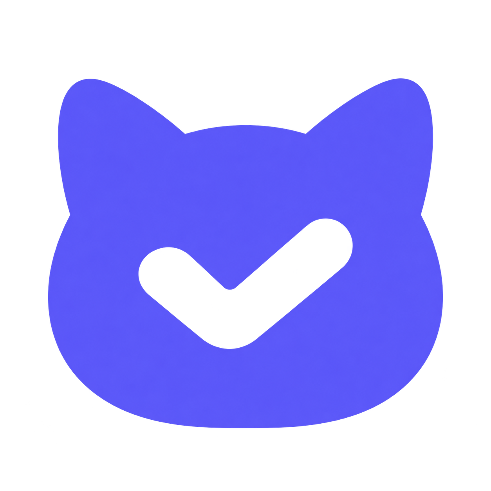
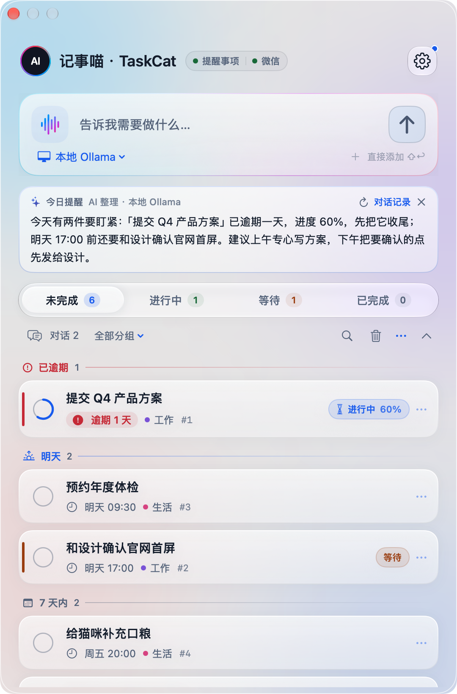
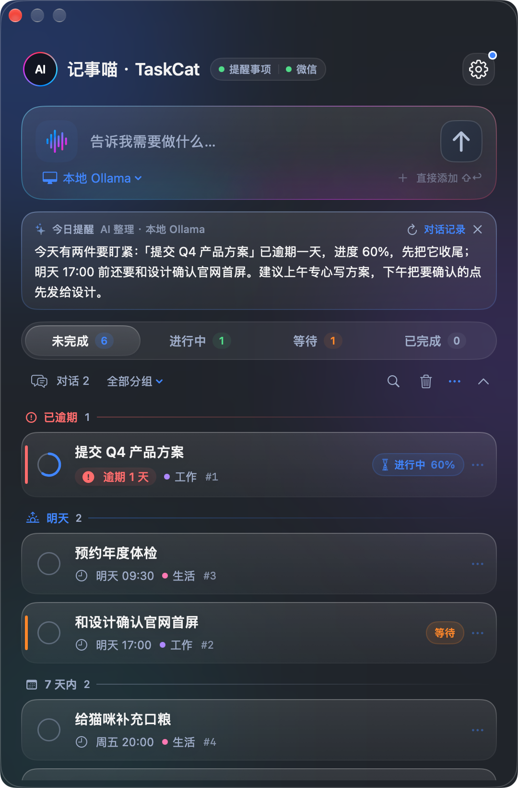
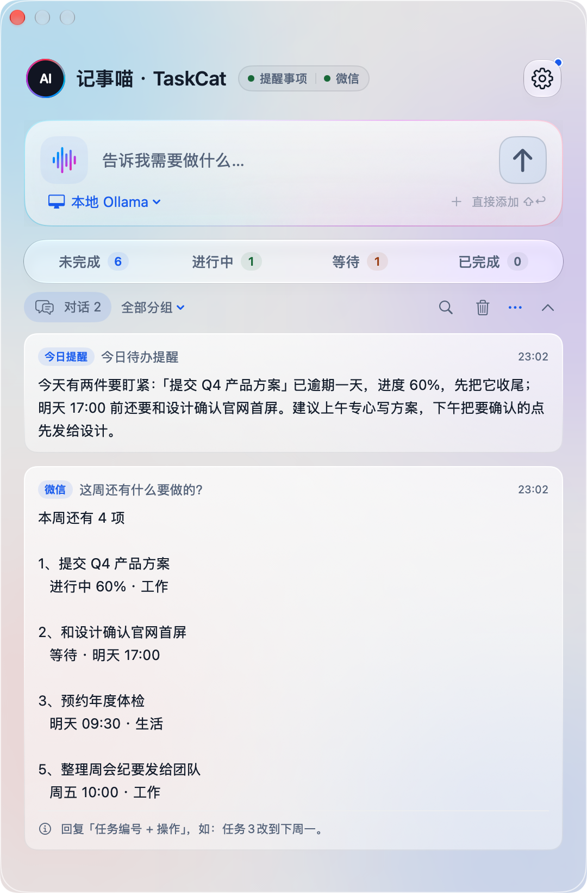

<p align="center">
  
</p>

<h1 align="center">记事喵 · TaskCat</h1>

<p align="center"><strong>一句话，安排好每件事。</strong><br>住在 Mac 菜单栏的 AI 待办管家。电脑前按 ⌥⌘T，出门发一句微信，都能随手记。</p>

<p align="center">
  <a href="https://github.com/tab16360/taskcat/releases/latest"></a>
  
  <a href="LICENSE"></a>
  <a href="https://x.com/ai_funs"></a>
</p>

<p align="center">
  <a href="https://tab16360.github.io/taskcat/">官网</a> ·
  <a href="https://github.com/tab16360/taskcat/releases/latest">下载</a> ·
  <a href="GUIDE.md">使用指南</a> ·
  <a href="SECURITY.md">隐私与安全</a> ·
  <a href="https://x.com/ai_funs">X</a>
</p>

<p align="center">
  
  
</p>

## 为什么做它

待办工具不缺，缺的是**记下来的那一秒**。

- 脑子里冒出一件事，要打开 App、找列表、选日期、填分组，念头早就没了。
- 待办越积越多，打开列表只看到一堵墙，分不清哪件今天必须做。
- 人在外面想起一件事，只能先发给文件传输助手，回到电脑前再抄一遍，多半就忘了抄。

记事喵把这些都缩成一句话：**在电脑前按快捷键说一句，在外面发一句微信，它来整理；打开时，它先告诉你今天该先做什么。**

## 它能做什么

### 想到就记，不离开当前窗口

在任何 App 里按 <kbd>⌥</kbd><kbd>⌘</kbd><kbd>T</kbd>，输入框直接弹出。写一句“周五下午三点前交 Q4 方案，进度先记 40%”，回车交给 AI 理解成标题、截止时间、进度和分组；<kbd>⇧</kbd><kbd>↩</kbd> 则不经 AI，原样存为一条待办。

### 微信随手记

出门在外，想到什么就给记事喵发一句：“周四上午十点约牙医。”它理解时间和分组，直接记下：Mac 菜单栏和 iPhone 提醒事项同时出现，到点照常提醒。只有拿不准时才会先问你，比如没说清是哪件事，或日期太含糊。查这周安排、改时间、标完成也在同一个对话里。

在设置的“微信”里点“连接微信”，用手机微信扫码即可，不需要另外安装任何东西；语音消息同样能记。

### 每天第一次打开，先看到一段“今日提醒”

AI 会读一遍逾期、今天到期和进行中的事，用两三句话告诉你先做哪件、为什么。没配模型或模型不在线时，改由本机整理同样的摘要，提醒不会缺席。

### 列表按“什么时候要做”排好

已逾期、今天、明天、7 天内、以后，各成一段；逾期标红，进行中显示进度环。每行的“…”菜单里可以一键推迟到明天或下周一（保留原来的时刻）、切换状态、移到分组；点完成后几秒内可以撤销。菜单栏图标旁的数字，就是今天逾期加到期的件数。

<p align="center">
  
</p>

### 模型你自己选

支持任何 OpenAI 兼容接口（自备 Key），也可以接本地 Ollama，完全不出本机。多套配置随时切换，设置里能一键测试连接。不配置模型也能手动管理全部任务。

### 任务跟着设备走

基础任务存进系统“提醒事项”的专用列表：选 iCloud 账户后，iPhone 上能看到、能改，到期由系统通知，Mac 关机也照样提醒。两台 Mac 之间的状态、进度、编号和回收站，可以经你自己的 iCloud Drive 同步。

## 下载安装

1. 从 [Releases](https://github.com/tab16360/taskcat/releases/latest) 下载 `TaskCat-arm64.zip`，解压后把“记事喵.app”拖进“应用程序”。
2. 首次打开若被拦截：在“系统设置 → 隐私与安全性”底部点“仍要打开”。应用使用固定的自签名证书，没有经过 Apple 公证；不需要关闭任何系统安全功能。
3. 点“授权并连接”，允许访问提醒事项，选择账户。
4. 在设置的“AI 模型”里填服务地址、模型 ID 和 Key，点“测试连接”；也可以先手动添加任务。

之后有新版本会弹窗提醒，点“安装并重启”即可：下载后先校验 SHA-256、代码签名与应用标识，替换失败自动还原。macOS 14 以上；Apple Silicon 已实测，Intel 尚未验收。

## 隐私

- **Key**：只保存在本机应用配置目录（仅当前用户可读写），不进入备份，不跨机同步。
- **发给模型的内容**：你的输入、近期操作，以及最多 100 项相关任务的标题、状态、分组；每日提醒最多 12 项任务的标题、时间、状态。**不发送任务备注**。选本地模型时，一切留在本机。
- **更新检查**：只访问本仓库的 GitHub Releases，不发送任务数据，可在设置中关闭。

详见 [SECURITY.md](SECURITY.md)。

## 从源码构建

需要 Apple Silicon Mac、Xcode 或 Command Line Tools（含 macOS 26 SDK）。核心应用不依赖 Python、Node 或第三方包。

```bash
git clone https://github.com/tab16360/taskcat.git
cd taskcat
bash scripts/build-app.sh      # 生成 dist/TaskCat.app
bash scripts/install-app.sh    # 安装到“应用程序”并打开
```

构建脚本会优先使用本机专用钥匙串 `~/Library/Keychains/taskcat-signing.keychain-db` 里的自签名证书；没有时回退为临时签名（每次更新后 macOS 会重新询问提醒事项权限）。设置 `TASKCAT_SIGNING_IDENTITY` 可改用 Developer ID。

```text
apps/macos/Sources/     SwiftUI 界面、任务服务、微信连接、更新、同步
apps/macos/Resources/   Info.plist、模型指令与命令 Schema、更新脚本
poc/metadata-journal/   不可变操作日志与冲突检测
scripts/                构建、打包、安装、界面预览
tests/                  pytest 驱动的真实 Swift 行为测试
docs/                   官网（GitHub Pages）
```

## 测试

```bash
python3 -m venv .venv
.venv/bin/python -m pip install -r requirements-dev.txt
.venv/bin/python -m pytest tests -q
```

测试会编译真实的 Swift 代码并用合成数据运行，不访问你的提醒事项、钥匙串或微信；微信部分用本地模拟服务器验证登录、收发与去重。

## 微信连接说明

微信连接直接内置在 App 里（`WeChatBridge.swift` 等），按腾讯官方插件 [openclaw-weixin](https://www.npmjs.com/package/@tencent-weixin/openclaw-weixin)（MIT）公开的 iLink 协议用 Swift 实现，不依赖 Python 或第三方 SDK。收到的消息先写入本机持久收件箱，再交给任务服务处理；同一条消息不会被执行两次，回复结果不确定时会暂停而不是重发。登录信息只保存在本机 `~/.tasksecretary/wechat/`（仅当前用户可读写）。同一个微信请只连接一台 Mac。

## 已知边界

- 没有独立的 iOS App；手机端通过系统提醒事项查看和接收通知。
- AI 理解可能出错：拿不准时会先问你；每条回复都写明记下的内容和时间，不对可以直接改。设置里也能改成每次修改都先确认。
- 含重复规则或位置提醒的复杂任务，暂不支持完整的快照删除与恢复。
- 两台 Mac 的扩展同步遇到真实并发冲突时会暂停修改，等待核对。

## 参与

欢迎通过 [Issues](https://github.com/tab16360/taskcat/issues) 报告可复现的问题，提交前请读 [贡献指南](CONTRIBUTING.md)，不要附上个人任务、Key、二维码或微信会话。

关注作者：[@ai_funs](https://x.com/ai_funs)

## 许可证

[Apache License 2.0](LICENSE)。微信协议实现参考了腾讯 openclaw-weixin（MIT），见 [NOTICE](NOTICE)。
